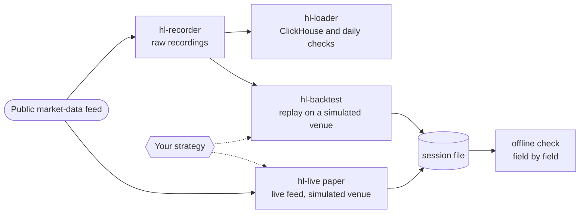

<div align="center">

# Aqueduct

**Open infrastructure for market making on order-book DEXs.**

Record the market. Replay it faithfully. Rehearse on a live feed.

[](https://github.com/R1cK-ChaN/aqueduct/actions/workflows/ci.yml)
[](#licence)

**English** · [简体中文](README.zh-CN.md)

</div>

## Why

More market makers mean tighter spreads and deeper books, and everyone
who trades gets a better price. What holds a new maker back is rarely
the idea. It is the infrastructure: recording the market, replaying it
faithfully, and rehearsing on a live feed.

Aqueduct builds that part in the open. A person or an AI agent can start
at the strategy. It begins with Hyperliquid perpetuals and is meant to
reach other order-book DEXs.

## How it fits together



The same strategy code runs in the backtest and in the paper session.
Both write a session file, and an offline replay checks it field by field.

## Try it in two minutes

You need Linux, Rust (the pinned toolchain installs itself through
[rustup](https://rustup.rs)) and the `zstd` command.

The repository carries a 60-second recording of one market as a test
fixture. Compress it, run the example quoter against it, then let the
replay check the session it wrote.

```bash
zstd -q -o /tmp/sample.hlrec.zst crates/hl-codec/tests/fixtures/hl_ws_pons_20261124.hlrec
```

```bash
cargo run --release -p hl-backtest -- run \
  --coin PONS --half-spread 0.00002 --qty 500 \
  --order-latency-ms 400 --report-latency-ms 250 --maker-fee-bps 1.5 \
  --session-out /tmp/session.jsonl /tmp/sample.hlrec.zst
```

```bash
cargo run --release -p hl-backtest -- run --check-session /tmp/session.jsonl
```

The second command prints a JSON summary: the events it read, the orders
it placed and modified, the fills and the account. The third prints
`session matches` and the number of rows. Sixty seconds is a smoke test
and says nothing about a strategy. [Usage](docs/usage.md) explains every
flag and field, how to record your own data and how to run a paper
session.

The first two commands do not overwrite a file. To run them again, remove
`/tmp/sample.hlrec.zst` and `/tmp/session.jsonl`.

## What Aqueduct builds, and what is yours

Aqueduct builds:

- a recorder for public market-data feeds and a documented raw format;
- decoders, an L2 book, and loading into ClickHouse with daily
  data-quality checks;
- a simulated venue with stated timing rules, a deterministic replay and
  a backtest command;
- paper sessions on the live feed, written to a session file that an
  offline replay checks field by field;
- a register of venue facts, each with its source and the date it was
  checked.

Yours:

- the strategy. It implements one trait, does no IO, and runs unchanged
  in backtest and paper;
- the research: which runs to make and how to judge them;
- every trading decision. Nothing here places an order on a venue.

The repository ships one example quoter and no results. A simulator
cannot know everything about a live market. The assumptions this one
makes, and where each would have to be measured, are listed under
"Limits against live trading" in
[RFC 0008 D8](docs/rfc/0008-paper-trading.md#d8-replay-the-recording-and-compare-decisions-in-order).

## Status

| Part | Crates | State |
| --- | --- | --- |
| Recorder for public feeds | `hl-recorder` | Working. [HL-41](docs/venues/hyperliquid.md#hl-41), [BN-8](docs/venues/binance.md#bn-8) |
| Decoders and L2 book | `hl-codec`, `hl-book` | Working for Hyperliquid frames and the official archives. Books rebuild from diffs. [HL-97](docs/venues/hyperliquid.md#hl-97), [HL-105](docs/venues/hyperliquid.md#hl-105) |
| Loading and daily data-quality checks | `hl-loader` | Working |
| Simulated venue | `hl-sim` | Working, minimal: post-only orders, filled by a trade strictly through the price |
| Replay and backtest | `hl-run`, `hl-backtest` | Working, one coin per run |
| Paper session | `hl-live` | Working |
| Dated price and size rules | `hl-rules` | Written, not yet applied by the simulator. [RFC 0009 D7](docs/rfc/0009-instrument-identity.md#d7-supply-dated-rules-to-backtest-and-paper-runs) |
| Public recording dataset | `hl-publish` | Designed, not yet available. [RFC 0010 D8](docs/rfc/0010-public-recording-dataset.md#d8-order-of-later-issues) |
| Live order gateway | `hl-gateway` | Interface only |
| Risk limits and watchdog | `hl-risk`, `hl-watchdog` | Not started |

`FixedSpreadQuoter` is the only strategy included.

## For people and for agents

The same rules serve a human reader and a coding agent:

- the same inputs give the same outputs, so a result can be reproduced
  and compared byte for byte;
- `hl-backtest run --check-session` replays a session and reports the
  first field that differs;
- a statement about a venue cites its register entry instead of
  restating it;
- [AGENTS.md](AGENTS.md) holds the working rules for both.

## Documentation

- [Usage](docs/usage.md): build, test, run a backtest and a paper session.
- [Documentation map](docs/INDEX.md): every document and what it owns.
- [Architecture](docs/ARCHITECTURE.md): crates, dependencies and data flow.
- [RFC 0001](docs/rfc/0001-core-types-and-interfaces.md): why the core
  interfaces look the way they do.
- [Venue register](docs/venues/README.md): venue rules and measurements,
  each with a source.

## Roadmap and contributing

- **Venues.** The code supports Hyperliquid today. Lighter is planned
  next. Crates carry the `hl-` prefix because they were written for one
  venue; the names will be revisited when the second venue is added.
- **Learning material.** A `learn/` directory is planned, from what a
  maker does to why a backtest can mislead.
- **Contributions** are welcome. Read [AGENTS.md](AGENTS.md) first. A
  change to a shared interface starts as an RFC in `docs/rfc/`.

## The name

An aqueduct carries water to a city: built once, used by everyone. Here
the water is liquidity and the channel is this infrastructure.

## Licence

You may use this code under either the MIT License or the Apache License,
Version 2.0, at your option (`MIT OR Apache-2.0`).
[MIT](LICENSE-MIT) · [Apache-2.0](LICENSE-APACHE)

Unless you explicitly state otherwise, any contribution you intentionally
submit for inclusion in this project, as defined in the Apache License,
Version 2.0, is dual-licensed as above, without additional terms or conditions.
