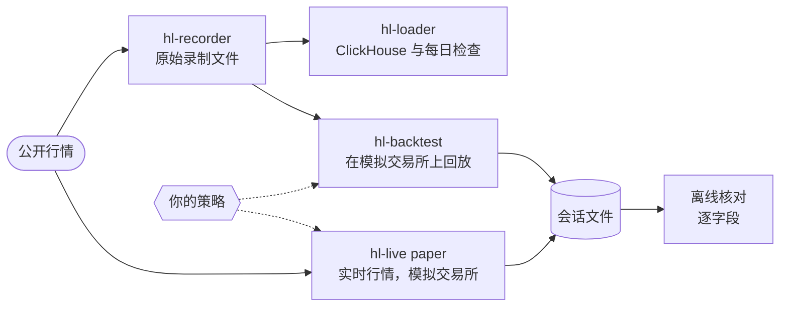

<div align="center">

# Aqueduct

**面向订单簿 DEX 做市的开放基础设施。**

把行情录下来，忠实地回放，在实时行情上演练。

[](https://github.com/R1cK-ChaN/aqueduct/actions/workflows/ci.yml)
[](#许可证)

[English](README.md) · **简体中文**

</div>

## 为什么做这件事

做市的人越多，价差越小，深度越好，每个来交易的人都能拿到更好的价格。
拦住新做市者的往往不是想法，而是基础设施：把行情录下来，忠实地回放，
在实时行情上演练。

Aqueduct 把这一部分公开做出来。人也好，AI Agent 也好，都可以直接从策略
开始。它从 Hyperliquid 永续合约起步，目标是覆盖更多订单簿 DEX。

## 整体结构



回测和模拟盘运行的是同一份策略代码。两者都会写出会话文件，离线回放再
逐字段核对。

## 两分钟上手

需要 Linux、Rust（工具链版本已固定，通过 [rustup](https://rustup.rs)
自动安装）和 `zstd` 命令。

仓库里带有一段 60 秒的单一市场录制，原本是测试样本。先压缩它，用示例
报价策略跑一遍回测，再让回放程序核对刚写出的会话。

```bash
zstd -q -o /tmp/sample.hlrec.zst crates/hl-codec/tests/fixtures/hl_ws_pons_20261124.hlrec
```

```bash
cargo run --release -p hl-backtest -- run \
  --coin PONS --half-spread 0.00002 --qty 500 \
  --order-latency-ms 400 --report-latency-ms 250 --maker-fee-bps 1.5 \
  --session-out /tmp/session.jsonl /tmp/sample.hlrec.zst
```

```bash
cargo run --release -p hl-backtest -- run --check-session /tmp/session.jsonl
```

第二条命令打印一份 JSON 摘要：读到的事件、下单和改单、成交、账户。
第三条打印 `session matches` 和行数。60 秒只够验证流程跑通，不能说明任何
策略的好坏。每个参数和字段的含义、如何录制自己的数据、如何运行模拟盘，
见[使用说明](docs/usage.md)（英文）。

前两条命令不会覆盖已有文件。要重新运行，先删掉 `/tmp/sample.hlrec.zst` 和
`/tmp/session.jsonl`。

## Aqueduct 负责什么，什么归你

Aqueduct 负责：

- 公开行情的录制器，以及有文档的原始格式；
- 解码器、L2 订单簿，写入 ClickHouse 并做每日数据质量检查；
- 一个时序规则写明的模拟交易所、确定性的回放和回测命令；
- 实时行情上的模拟盘，写出会话文件，由离线回放逐字段核对；
- 一份交易所事实登记册，每条都带来源和核对日期。

归你：

- 策略。它实现一个 trait，不做任何读写，在回测和模拟盘里原样运行；
- 研究：跑哪些组合，怎么评判结果；
- 每一个交易决定。这里没有任何代码会向交易所下单。

仓库只带一个示例报价策略，不带任何结果。模拟器不可能知道实盘的一切。
它做了哪些假设、每条假设要在哪里实测，列在
[RFC 0008 D8](docs/rfc/0008-paper-trading.md#d8-replay-the-recording-and-compare-decisions-in-order)
的 “Limits against live trading” 一段。

## 现状

| 部分 | Crate | 状态 |
| --- | --- | --- |
| 公开行情录制器 | `hl-recorder` | 可用。[HL-41](docs/venues/hyperliquid.md#hl-41)、[BN-8](docs/venues/binance.md#bn-8) |
| 解码器与 L2 订单簿 | `hl-codec`、`hl-book` | 支持 Hyperliquid 的行情帧和官方归档，订单簿可由增量重建。[HL-97](docs/venues/hyperliquid.md#hl-97)、[HL-105](docs/venues/hyperliquid.md#hl-105) |
| 入库与每日数据质量检查 | `hl-loader` | 可用 |
| 模拟交易所 | `hl-sim` | 可用，功能最小：只接受被动挂单，成交价严格穿过挂单价才算成交 |
| 回放与回测 | `hl-run`、`hl-backtest` | 可用，每次运行一个币种 |
| 模拟盘 | `hl-live` | 可用 |
| 按日期生效的价格与数量规则 | `hl-rules` | 已写好，模拟器尚未使用。[RFC 0009 D7](docs/rfc/0009-instrument-identity.md#d7-supply-dated-rules-to-backtest-and-paper-runs) |
| 公共录制数据集 | `hl-publish` | 已设计，尚未提供。[RFC 0010 D8](docs/rfc/0010-public-recording-dataset.md#d8-order-of-later-issues) |
| 实盘下单网关 | `hl-gateway` | 只有接口 |
| 风控与看门狗 | `hl-risk`、`hl-watchdog` | 尚未开始 |

仓库只包含 `FixedSpreadQuoter` 这一个策略。

## 给人，也给 Agent

同一套规则同时服务读文档的人和写代码的 Agent：

- 同样的输入得到同样的输出，结果可以复现，并逐字节比较；
- `hl-backtest run --check-session` 回放一个会话，报告第一个不一致的字段；
- 关于交易所的说法一律引用登记册条目，不重复叙述；
- [AGENTS.md](AGENTS.md) 是两者共用的工作规则。

## 文档

- [使用说明](docs/usage.md)：构建、测试、运行回测和模拟盘。
- [文档地图](docs/INDEX.md)：每份文档及其负责的内容。
- [架构](docs/ARCHITECTURE.md)：crate、依赖关系和数据流向。
- [RFC 0001](docs/rfc/0001-core-types-and-interfaces.md)：核心接口为什么
  是现在的样子。
- [交易所登记册](docs/venues/README.md)：交易所规则和测量结果，每条都有
  来源。

除本页外，文档目前只有英文。

## 路线图与参与贡献

- **交易所。** 目前支持 Hyperliquid，下一个计划是 Lighter。crate 名带
  `hl-` 前缀，是因为代码最初只为一个交易所而写；接入第二个交易所时会
  重新命名。
- **学习材料。** 计划增加 `learn/` 目录，从做市者在做什么，讲到回测
  为什么会误导人。
- **欢迎贡献。** 请先读 [AGENTS.md](AGENTS.md)。改动共享接口要先在
  `docs/rfc/` 写 RFC。代码、文档和讨论使用英文。

## 名字

Aqueduct 的意思是引水渠。引水渠把活水引进城里：修一次，所有人受益。
在这里，水是流动性，渠是这套基础设施。

## 许可证

你可以任选 MIT 许可证或 Apache 许可证 2.0 版使用本项目的代码
（`MIT OR Apache-2.0`）。[MIT](LICENSE-MIT) · [Apache-2.0](LICENSE-APACHE)

除非你明确另行声明，你有意提交并入本项目的任何贡献（定义见 Apache 许可证
2.0 版）都按上述双许可授权，不附加其他条款或条件。
